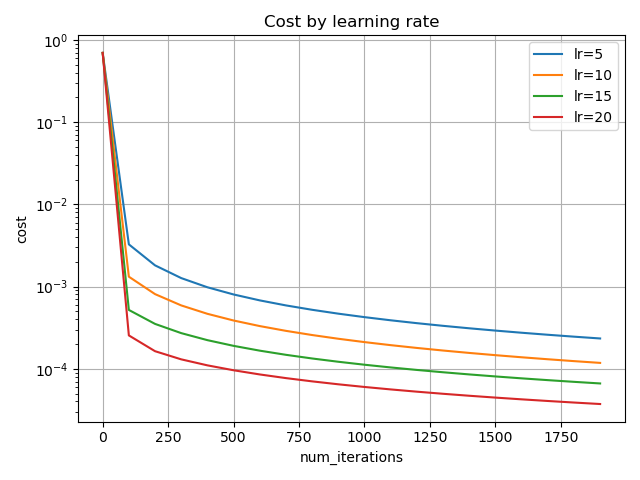
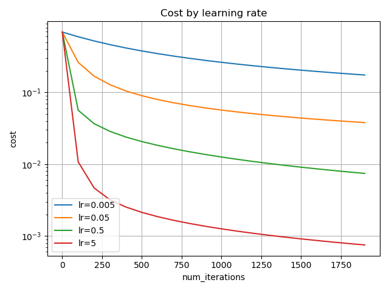

# 여섯가지 질문

**손실 함수로 제곱 오차 대신 로그 손실을 쓰는 이유는 무엇인가?**

Sigmoid는 출력값이 0 또는 1에 가까워질수록 미분값이 작아지는 특성을 가진다.

따라서 제곱 손실을 사용할 경우, 실제 정답과 예측값의 차이가 크더라도  Sigmoid의 출력값이  
 0 또는 1에 가까우면 미분값이 작아져 학습이 느려지는 문제가 발생할 수 있다.

반면 로그 손실을 사용하면 연쇄법칙에 의해 기울기가 A-Y로 정리되므로, Sigmoid의 미분값으로  
 인해 기울기가 추가적으로 작아지는 문제를 피할 수 있다.

 

**dw 의 shape은 몇 인가?**

dw는 각 가중치에 대응하는 비용의 편미분을 모은 벡터이다. 
따라서 가중치 하나마다 기울기가 하나씩 존재하며,   $w = w - \alpha * dw$ 에서 각 가중치를 대응하는 기울기로 갱신하므로 dw를 w와 동일한 (n, 1) 형태로 구성한다.

 

**학습률 5에서 무슨 일이 일어났는가?**

학습률 5에서 가장 낮은 비용함수 값을 기록하였다.

높은 학습률에서도 발산하거나 진동하지 않는 현상에 의문이 들어 학습률을 5, 10, 15, 20으로 설정하여  
추가적인 실험을 진행 하였다. 

5,10,15,20 학습률에서 앞과 마찬가지로 학습 속도가 빨라지는 현상만 관측되며 진동하는 현상은 발생하지 않았다.

이러한 현상이 데이터의 분류 난이도와 관련 있는지 확인하기 위해 상대적으로 구분하기 어려운 3과 5 클래스를  
 대상으로 추가 실험을 진행하였다.

마찬가지로 동일한 현상이 확인 되어 데이터 자체가 쉬운 것이 아닌 로지스틱 회귀 자체가 가중치가 적기에  
일어난 현상으로 보인다.

 

**여기서는 w 를 0으로 초기화해도 문제가 없었다. 왜 괜찮은가?**

ReLU는 0에서 미분이 정의되지 않지만, 구현에서는 보통 미분값을 0으로 처리하므로 0 초기화로 인해 기울기가 차단될 수 있다.
 

반면 이번 로지스틱 회귀에서는 가중치와 편향을 0으로 초기화하면 시그모이드 출력 A가 0.5가 된다.   
시그모이드와 로그 손실을 결합한 Z에 대한 기울기는 A−Y이며, 정답 Y는 0 또는 1이므로 각 샘플에서 이 값은 0이 아니다.  
이를 입력값과 함께 계산한 가중치 기울기도 일반적으로 0이 아니므로, 0으로 초기화해도 가중치를 업데이트하며 학습할 수 있다.  

또한 로지스틱 회귀의 경우 단일 뉴런 신경망으로 다중 뉴런 신경망에서 나타날 수 있는 같은 층의 뉴런들이 같은 가중치로 업데이트 되는 문제가 발생하지 않는다.

 

**실험 2(숫자 3과 5 분류)에서 train 정확도와 test 정확도에 차이가 생겼다면, 그 차이는 무엇을 의미하는가?**

train 정확도보다 test 정확도가 낮다면, 테스트 데이터에 훈련 과정에서 충분히 학습하지 못한 패턴이나 특징이 포함되어 성능 차이가 발생했을 수 있다.   
이는 제한된 훈련 데이터에서 학습한 판단 기준이 새로운 데이터의 다양한 사례에 모두 잘 적용되지는 않을 수 있기 때문이다.  이러한 성능 차이를 일반화 격차라고 하며, 훈련 정확도만으로 새로운 데이터에 대한 성능을 판단해서는 안 되는 이유를 보여준다.
 
 

**버그를 넣었을 때 기울기 검증의 상대 오차는 어떻게 변했는가. 이 검증으로 잡을 수 없는 버그는 어떤 것이 있을까?**

정상 구현의 상대 오차는 약 1.06e-9였지만, dw의 평균 계수를 제거하면  
약 0.816, db의 부호를 바꾸면 약 0.236, 정상 dw에 2를 곱하면 약 0.329로 증가했다.   
이를 통해 수치 기울기와 역전파 기울기의 불일치를 검출할 수 있음을 확인하였다.

기울기 검증은 수치 기울기와 해석적 기울기를 비교하므로, 기울기 계산 외의 학습 과정에서 발생하는 오류는 발견하지 못할 수 있다.

예를 들어 역전파가 올바르게 구현되었더라도 가중치 업데이트 방향을 잘못 설정하면 기울기 검증을 통과하지만, 학습 과정에서는 비용함수가 증가할 수 있다.
