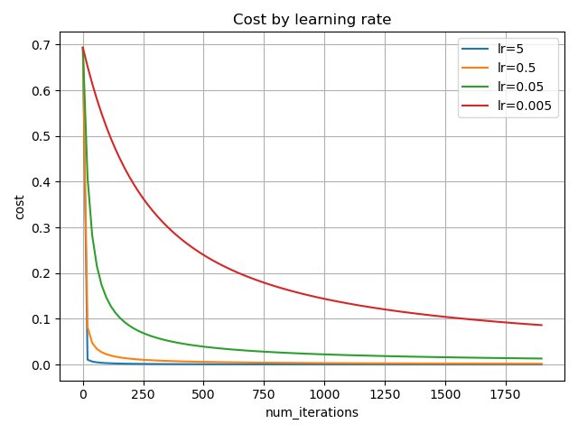

# 여섯가지 질문

**손실 함수로 제곱 오차 대신 로그 손실을 쓰는 이유는 무엇인가?**

전역 최솟값이 아닌 국소 최솟값에 갇히는 문제가 없다는 장점을 가진다.  
또한 시그모이드와 결합하면 샘플별 기울기가 a-y로 정리된다.

 

**dw 의 shape은 몇 인가?**

dw는 각 가중치에 대응하는 비용의 편미분을 모은 벡터이다.  
따라서 가중치 하나마다 기울기가 하나씩 존재하며, $w = w - \alpha * dw$ 에서 각 가중치를 대응하는 기울기로 갱신하므로 ,  dw를 w와 동일한 (n, 1) 형태로 구성한다.

 

**학습률 5에서 무슨 일이 일어났는가?**

학습률 5에서  빠르게 감소하여 빠르게 수렵 하게 되어 비용함수 값의 감소폭이 현상을 가지게 된다.   
초반의 변화를 더 자세히 확인하기 위해 비용을 20회 반복마다 기록하였다.  
그 결과, 약 40회 이후부터는 초기 구간에 비해 비용의 감소 폭이 작아져, 그래프가 완만해지는 모습을 확인할 수 있었다.

 

**여기서는 w 를 0으로 초기화해도 문제가 없었다. 왜 괜찮은가?**

ReLU는 0에서 미분이 정의되지 않지만, 구현에서는 보통 미분값을 0으로 처리하므로 0 초기화로 인해 기울기가 차단될 수 있다.
 

반면 이번 로지스틱 회귀에서는 가중치와 편향을 0으로 초기화하면 시그모이드 출력 A가 0.5가 된다. 시그모이드와 로그 손실을 결합한 Z에 대한 기울기는 A−Y이며, 정답 Y는 0 또는 1이므로 각 샘플에서 이 값은 0이 아니다. 이를 입력값과 함께 계산한 가중치 기울기도 일반적으로 0이 아니므로, 0으로 초기화해도 가중치를 업데이트하며 학습할 수 있다.

 

**실험 2(숫자 3과 5 분류)에서 train 정확도와 test 정확도에 차이가 생겼다면, 그 차이는 무엇을 의미하는가?**

train 정확도보다 test 정확도가 낮다면, 테스트 데이터에 훈련 과정에서 충분히 학습하지 못한 패턴이나 특징이 포함되어 성능 차이가 발생했을 수 있다.  
이는 제한된 훈련 데이터에서 학습한 판단 기준이 새로운 데이터의 다양한 사례에 모두 잘 적용되지는 않을 수 있기 때문이다.  이러한 성능 차이를 일반화 격차라고 하며, 훈련 정확도만으로 새로운 데이터에 대한 성능을 판단해서는 안 되는 이유를 보여준다.
 
 

**버그를 넣었을 때 기울기 검증의 상대 오차는 어떻게 변했는가. 이 검증으로 잡을 수 없는 버그는 어떤 것이 있을까?**

정상 구현의 상대 오차는 약 1.06e-9였지만, dw의 평균 계수를 제거하면  
약 0.816, db의 부호를 바꾸면 약 0.236, 정상 dw에 2를 곱하면 약 0.329로 증가했다.   
이를 통해 수치 기울기와 역전파 기울기의 불일치를 검출할 수 있음을 확인하였다.