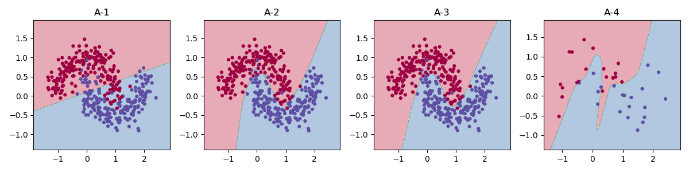

# 여섯가지 질문

## 로지스틱으로는 초승달 문제를 풀 수 없는 이유

초승달 데이터의 경우 잘 분리 하기 위해서는 결정 함수가 곡선 형태여야 한다.  
하지만 로지스틱 회귀의 경우 선형 분리만 가능하기에 완벽한 분리가 불가능 하다.

## 은닉 유닛을 12배로 늘려도 과적합 되지 않는 이유 

은닉 유닛을 약 12배 늘렸지만, 결정 경계의 전체적인 형태는 크게 달라지지 않았기 때문이다. 

  
(그림 1)
                    

그림 1의 A-2와 A-3를 비교하면, A-3에서는 일부 구간의 위치와 굴곡이 조정되었다.  

이는 초승달 데이터의 분포에 따라 신경망이 특정 함수의 형태를 유지하도록 편향 되어서 그 형태 내에서  
더 정확한 방향을 찾는 형태가 되었다고 생각한다. 

## 과적합인지는 뭐를 보고 판단하는가?

일반적으로는 train내에서의 비용 곡선과 test 내에서의 비용 곡선을 비교하여 판단한다.

구체적으로 학습에서 시험 비용에 대해서 최소 이후에 상승폭이 지속적으로 가파르게 올라가는 보아서 판단하고자 한다. 

## B-1,B-2,B-4의 결과의 이유는?

B-1는 기울기 값이 0이 되면서 학습이 동작하지 않게 된다.  
B-2는 dW2는 A1이 0이기에 dW2가 0이 되지만 $dZ_1=W_2^\top dZ_2$이기에 $dW_1=\frac1m dZ_1X^T$으로 W1은 업데이트가 되게 된다.
  
따라서 dW2 또한 A1이 0이 아니게 되면서 정상적으로 학습이 가능해진다. 
B-4는 모든 가중치가 동일한 값을 가지게 되면서 각 레이어 내의 노드들의 기울기가 같아지는 대칭성 문제가 발생하게 된다. 

## 과제 1의 3 vs 5를 시험 비용까지 기록해 다시 돌리면, 실험 A의 어느 모양에 해당하는가 ?

A-3의 정상적인 학습 양상과 유사하게, 학습 비용과 시험 비용이 모두 감소하였다.

시험 비용이 학습 비용보다 높아 격차는 존재하지만, 시험 비용의 재상승이 나타나지 않아 과적합의 징후가 없다고 판단하였다.

## 과제 1에서 큰 학습률이 발산하지 않은 진짜 이유는 무엇인가? 

시그모이드와 로그 손실을 같이 사용하게 될 경우 모델의 예측 확률이 정답과 같아지게 될 수록 a(1-a)가 작아지게 되어 곡률이 낮아지게 된다.

이에 따라 가중치 변화에 따른 기울기 dW의 변화가 완만해지며, 곡률이 크지 않아 큰 학습률에서도 비용이 안정적으로 감소할 수 있게 되었다.