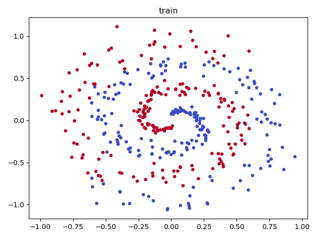

# 일곱가지 질문


## A-1(로지스틱 회귀) 은 나선 데이터에서 왜 60% 근처에 머무는가? 





나선 데이터의 경우 초승달 데이터 보다 꺽이는 정도가 높으며 두 데이터가 서로 감겨 있는 특징을 가진다. <br>
따라서 직선의 경우 두 클래스가 번갈가면서 나오기에 어떤 각도에서의 직선이라도 충분히 분리하기 어렵다.

<hr>

## A-3(2층, 은닉 64)과 A-5(3층, 16-16) 시험 정확도를 비교하면 무엇을 알 수 있는가?

A-3의 경우 시험 정확도가 90퍼를 넘지 못하지만 A-5의 경우 시험 정확도가 90퍼를 넘는다. <br>
이는 두 신경망의 깊이 차이로 인한 성능 차이로 해석 해볼 수 있다. 

신경망의 경우 깊은 층에서 이전 층의 정보를 기반으로 더욱 복잡한 함수를 표현할 수 있다.<br>
따라서 A-5의 경우 A-3가 만들지 못한 복잡한 경계를 만들어 높은 분리 성능을 내었다고 생각한다.


<hr>

## A-4(2층, 은닉 256)와 A-5(3층, 16-16) 의  시험 정확도 90%에 도달한 반복 횟수를 비교하면 무엇을 알 수 있는가?

두 가지로 해석 해볼 수 있다. 

첫번쨰는 A-4가 파라미터가 많은 점과 A-5가 파라미티가 적고 깊은 층으로 인해서 <br>
최적화 측면에서 A-5가 좋은 효율을 보여 준 것으로 해석해볼 수 있다. 

하지만 보통의 경우 깊은 신경망은 기울기 소실과 같은 문제로 인해서 최적화가 쉽다고 애기할 수 없다

따라서 두번째 경우는 깊이로 인하여 생기는 일반화 성능 차이로 생각해볼 수 있다. 

컨볼루션 네트워크와 같은 딥러닝 기법에서 깊이가 깊어질 수록 , 정확하는 모델의 크기가 커질 수록 
일반화 성능이 올라간다고 애기한다. 

이와 비슷하게 A-5의 경우에서도 깊이가 깊어지게 되어 더욱 빠르게 일반화 성능이 올라온 것으로 해석 해볼 수도 있다.


<hr>

## 2번과 3번을 합쳐서, 깊게 쌓으면 좋아지는 것 두 가지를 말하라.

첫번째는 복잡한 함수를 더 적은 파라미터로 만들 수 있다는 점이다. 

층을 깊게 쌓으면 앞선 층에서 만든 특징을 다음 층에서 다시 조합하여, <br>
비슷한 수의 파라미터로도 복잡한 결정 경계를 표현할 수 있다.

두번째는 일반화 성능의 향상이다. 

신경망이  아닌 이전 층에서의 특징을 이용하여 다음 층의 특징을 만드는 과정에서 <br>
신경망이 데이터 상에서의 규칙을 학습하기 쉽기에 향상 된다고 해석할 수 있다.


<hr>

## 실험 B에서 0.01 로 초기화한 4층 망의 비용이 서 거의 움직이지 않았다면 이는 무엇을 의미하는 가?

거의 0에 가까운 값이 출력된다고 할 수 있다. 

이는 깊이가 깊어질수록 Z에서 0에 가까운 값들이 계속 곱해져서 최종적으로 0에 가까운 값을 가지게 되어 <br>
입력에 상관없이 항상 0에 가까운 값을 출력하게 된다.


<hr>

##  A-3과 A-5를 seed 3개로 돌린 결과를 비교

A-3 보다 A-5가 변경에 민감하지 않다.
이는 A-5의 경우 복잡한 결정 경계를 표현할 수 있기에 어떤 해로 수렴하였든 간에 최적화 될 경우 <br>
해당 데이터에 대한 좋은 성능을 보여주는 결정 경계를 만들 수 있었다. 

하지만 A-3의 경우 A-5 비해 복잡한 결정 경계를 만들어 낼 수 없다. 따라서 나선 데이터에 대해서 <br>
놓치는 구간이 생길 수 밖에 없다. 

따라서 각 시드 마다 다른 부분에 대해서 학습을 하게 되어 놓치는 구간 다르기에 특정 시드에서 <br>
잘 분리하는 구간 보다 놓치는 구간이 커 성능면에서 큰 차이를 보여준 것으로 해석 되어진다.

이는 특정 시드에서만 결과값이 높고 나머지 시드에서 성능이 낫다면 해당 모델이 현재 데이터에 대한 <br>
분류 또는 예측 하는 능력이 부족할 수 있다는 것을 보여주는 지표로 여러 시드에서 일관적인 성능을 <br>
내야 하는지 또한 확인해야 한다고 생각한다.


<hr>

## 과제 1부터 지금까지 만든 모델은 로지스틱 회귀 → 2층 → L층으로 이어진다. 뒤의 것이 앞의 것을 포함한다는 사실을 코드로 어떻게 확인했는가.

코드를 짜는 과정에서 재사용하면서 이해하였다. 

먼저 얕은 신경망과 심층 신경망에서 로지스틱 회귀에서의 sigmoid 함수를 재사용하여 사용한다.

또한 얕은 신경망의 경우 로지스틱 회귀의 코드가 출력층으로 그대로 사용된다. 

로지스틱 회귀 순전파 코드 

```
  Z=w.T@ X + b
  A=sigmoid(Z)
```

얕은 신경망 출력층 코드 
```
    Z2=W2@A1 +b2
    A2=sigmoid(Z2)
```

이는 심층 신경망 코드에서도 다른 형태로 재사용한다.

```
        if (l==L):
            A,cache= linear_activation_forward(A_prev,parameters[f"W{l}"],parameters[f"b{l}"],sigmoid)
```

이것은 순전파 뿐만 아니라 역전파에서도 동일하게 적용된다.

```
    dZ= A-Y 
    dw= (X @ dZ.T)/m
    db= np.mean(dZ)
```

```
    dZ2=cache["A2"]-Y
    dW2=(dZ2@cache["A1"].T)/m
```

```
    dZ = sigmoid(ZL) - Y
    dA_prev, dW, db = linear_backward(dZ, caches[f"{L}"])
```

따라서 현재 모든 모델들은 로지스틱 회귀와 같은 이진 분류 문제를 단계별로 좀 하고 있는 것을 알 수 있다.

심층 신경망에서는 얕은 신경망의 이전 A를 입력으로 쓰는 구조를 반복문형태로 사용하고 있다.

얕은 신경망 순전파 코드
```
    Z1=W1@X +b1
    A1=tanh(Z1)
    Z2=W2@A1 +b2
    A2=sigmoid(Z2)
```

심층 신경망 순전파 코드


```
    for l in range(1,L+1):

        if (l==L):
            A,cache= linear_activation_forward(A_prev,parameters[f"W{l}"],parameters[f"b{l}"],sigmoid)
            AL=A
            ZL=cache["Z"]
        else:
            A,cache= linear_activation_forward(A_prev,parameters[f"W{l}"],parameters[f"b{l}"],relu)

        A_prev=A
```

이는 역전파 과정에서도 동일하다. 

따라서 여기서도 얕은 신경망의 은닉층 구조를 그대로 늘려서 사용한다고 애기할 수 있다.


  

