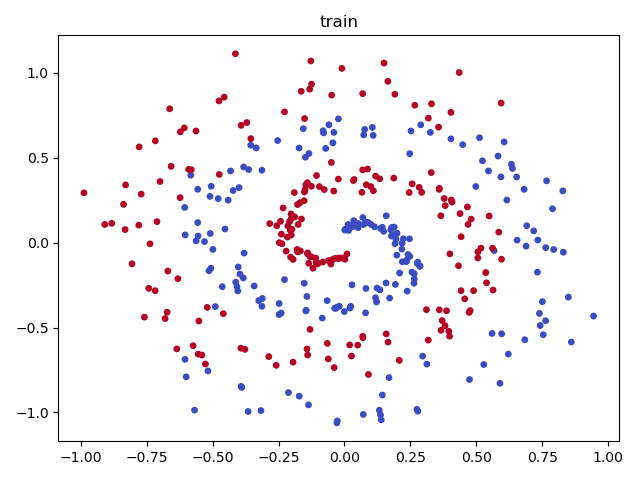

# 일곱가지 질문

## A-1(로지스틱 회귀) 은 나선 데이터에서 왜 60% 근처에 머무는가? 

나선 데이터의 경우 초승달 데이터 보다 꺽이는 정도가 높으며 두 데이터가 서로 감겨 있는 특징을 가진다.  
따라서 직선의 경우 두 클래스가 번갈가면서 나오기에 어떤 각도에서의 직선이라도 충분히 분리하기 어렵다.

## A-3(2층, 은닉 64)과 A-5(3층, 16-16) 시험 정확도를 비교하면 무엇을 알 수 있는가?

A-3의 경우 시험 정확도가 90퍼를 넘지 못하지만 A-5의 경우 시험 정확도가 90퍼를 넘는다.  
이는 두 신경망의 깊이 차이로 인한 성능 차이로 해석 해볼 수 있다. 

신경망의 경우 깊은 층에서 이전 층의 정보를 기반으로 더욱 복잡한 함수를 표현할 수 있다. 
A-5는 A-3에서 만들기 어려웠던 복잡한 경계를 만들어 높은 분리 성능을 내었다고 생각한다.

## A-4(2층, 은닉 256)와 A-5(3층, 16-16) 의  시험 정확도 90%에 도달한 반복 횟수를 비교하면 무엇을 알 수 있는가?

A-5가 A-4보다 적은 파라미터를 사용하고 층이 더 깊다는 점으로 인해서  
최적화 측면에서 A-5가 좋은 효율을 보여 준 것으로 해석해볼 수 있다. 

이는 최적화 과정에서 층을 분리할 수록 가중치에 따른 여러 조합이 생기게 된다. 

이로 인해 입력에 대한 출력이 업데이트 과정에서 두 출력에 따라  
다른 값을 업데이트 할 수 있기에 깊을 수록 잘 될 수 있다.

## 2번과 3번을 합쳐서, 깊게 쌓으면 좋아지는 것 두 가지를 말하라.

첫번째는 복잡한 함수를 더 적은 파라미터로 만들 수 있다는 점이다. 

층을 깊게 쌓으면 앞선 층에서 만든 특징을 다음 층에서 다시 조합하여,  
비슷한 수의 파라미터로도 복잡한 결정 경계를 표현할 수 있다.

두번째는 학습 효율이다. 

신경망이 여러 층으로 생겨난 조합으로 인하여 학습 측면에서 더욱 높은 효율을 보여주게 된다.

## 실험 B에서 0.01 로 초기화한 4층 망의 비용이 거의 움직이지 않았다면 이는 무엇을 의미하는가?

거의 0에 가까운 값이 출력된다고 할 수 있다. 

이는 깊이가 깊어질수록 Z에서 0에 가까운 값들이 계속 곱해져서 최종적으로  
ZL은 0에 가까운 값을 가지게 되어 입력에 상관없이 예측 확률이 0.5에 가깝게 되게 된다.

##  A-3과 A-5를 seed 3개로 돌린 결과를 비교

A-3 보다 A-5가 변경에 민감하지 않다.
이는 A-5의 경우 학습 효율 측면에서 깊이로 인해 좀 더 높은 성능을 보여 주어 최적화 될 경우  
시드에 상관없이 높은 성능을 보여주었다.

하지만 A-3의 경우 시드에 따라 시작 위치가 달라지게 되어 최적화 과정에 덜 수렵한 모델이 
존재하게 된다. 

이로 인해 A-3에서 낮은 성능이 보여주는 모델이 존재하게 된다.

## 과제 1부터 지금까지 만든 모델은 로지스틱 회귀 → 2층 → L층으로 이어진다. 뒤의 것이 앞의 것을 포함한다는 사실을 코드로 어떻게 확인했는가.

L층 신경망에서 layer_dims=[2,1]로 설정하면 은닉층이 없어 로지스틱 회귀와 같은 구조가 된다

따라서 이 둘의 정확도와 비용을 측정하였을 때 동일한 값을 가지게 되는지를 확인하고자 한다.

로지스틱 회귀의 정확도

>  로지스틱 회귀 훈련 정확도:  0.615
>  로지스틱 회귀 시험 정확도:  0.617

환원 정확도

>  환원 훈련 정확도:  0.615
>  환원 정확도:  0.617

로지스틱 회귀의 비용

>  로지스틱 회귀 훈련 비용:  0.6580494898763753
>  로지스틱 회귀 시험 비용:  0.6588415591173834

환원 비용

>  환원 훈련 비용:  0.6580494898763753
>  환원 시험 비용:  0.6588415591173834

두 구현의 최종 훈련·시험 정확도와 비용이 각각 일치하였다. 이를 통해 구현한 L층 신경망이  
로지스틱 회귀로 환원 가능함을 확인하였다