# numpy 워밍업


## 문제 1 

### 1.1 코드


```import time

a = np.random.rand(1000000)
b = np.random.rand(1000000)

start = time.perf_counter()
c_dot = np.dot(a,b)
end = time.perf_counter()

print("np.dot을 통한 결과값: ",c_dot)
print("넘파이 dot 걸린 시간: " + str(1000*(end-start))+" s")

c_for=0
start = time.perf_counter()
for i in range(1000000):
    c_for += a[i]*b[i]
end = time.perf_counter()

print("for을 통한 결과값: ",c_for)
print("for loop 걸린 시간: " + str(1000*(end-start))+" s")
print(c_dot==c_for)
print(np.allclose(c_dot,c_for))
```

### 1.2 for과 np.dot 걸린 시간 비교 

| 방법 | 소요시간 | 배수 |
| --- |  --- | --- |
| np.dot | 10.92 | 1배 |
| for loop | 163.625 | 16배 |

**for과 np.dot의 걸리시간이 차이나는 이유**  

for의 경우에는 파이썬 리스트를 사용해서 계산을 진행한다. 이 리스트 구조의 경우 2중 포인트를 
기반으로,<br> 다양한 데이터 타입을 허용가능하다는 장점을 가지지만 최소 2번 이상에 포인터 연산으로 인한 
오버헤드를 일으키게 된다.<br><br>
이와 반대로 넘파이 dot의 경우에는 넘파이 행렬을 사용한다. <br>이 넘파이 행렬은 c 언어에 배열과 동일한 구조로 연산을 진행하여 오버헤드가 없다는 차이점을 가진다.


###  1.3 결과값 비교 

| 방법 | 결과값 | 
| --- |  --- | 
| np.dot | 249917.35091018977 | 
| for loop | 249917.35091018115 | 

**정확히 같지 않은 이유**

내부 연산 과정에서 순서가 다르게 되는데 이로 인해 컴퓨터 상에 부동 소수점 연산과정에서의
반올림이 달라지게 되면서 오차가 생길 수 있다.

### 1.4 np.allclose(c_dot,c_for)
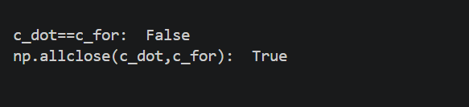

**np.allclose와 ==이 결과값이 다른 이유**

==연산자는 두 값이 정확히 같은 지를 비교하지만 np.allclose는 이 둘의 차이값이 허용 오차안에 존재한다면 True로 반환한다.

<br><br><br>


## 문제 2

### 2.1 코드

```
a=np.random.rand(3, 4)
print("열 정규화 keepdims False 결과값: \n",a/a.sum(axis=0,keepdims=False))
print("열 정규화 keepdims True 결과값: \n",a/a.sum(axis=0,keepdims=True))
print("각 열의 합: ",(a/a.sum(axis=0,keepdims=True)).sum(axis=0,keepdims=True))
print("각 열 검사:", np.isclose((a/a.sum(axis=0,keepdims=True)).sum(axis=0,keepdims=True), 1))

#print("행 정규화 keepdims False 결과값: \n",a/a.sum(axis=1,keepdims=False))
print("행 정규화 keepdims True 결과값: \n",a/a.sum(axis=1,keepdims=True))
print("각 행의 합: ",(a/a.sum(axis=1,keepdims=True)).sum(axis=1,keepdims=True))
print("각 열 검사:", np.isclose((a/a.sum(axis=1,keepdims=True)).sum(axis=1,keepdims=True), 1))

```

<br>
<br>


### 2.2 각 열 정규화한 결과 

| `keepdims=True` | `keepdims=False` |
| :---: | :---: |
| 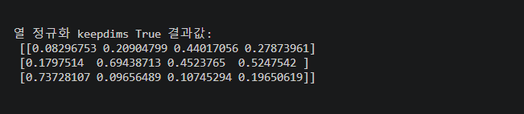| 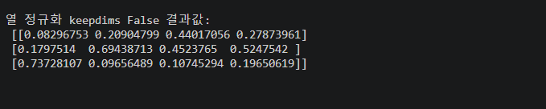|


### 2.3 각 열의 합 

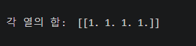


### 2.4 각 행 정규화한 결과값

| `keepdims=True` | `keepdims=False` |
| :---: | :---: |
| 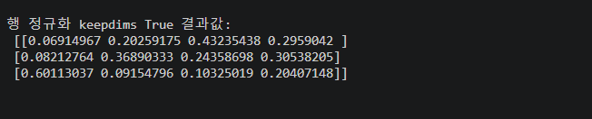| 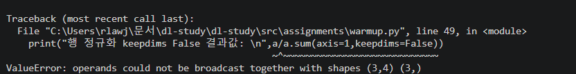|


**keepdims=False면 오류가 발생하는 이유**

keepdims는 차원을 유지하여 결과값을 만들어낸다. axis=0 일때 keepdims=False이면  (4,)이 된다.
<br>
NumPy의 Broadcasting 규칙에 따라 (4,)는 (1,4)처럼 오른쪽부터 정렬하여 비교되며 (1,4)는 (3,4)이 되어,a와 a.sum이 나누지는 것이 가능하다. <br><br>
하지만 axis=1일 때 keepdims=False (3,)이 되어 넘파이에 의해서 (1,3)이 되어지지만 , <br>
(3,4)과 (1,3)은 마지막 차원이 맞지 않기에  브로드 캐스팅이 불가능 하여서 계산이 되지 않고 오류가 발생한다.
<br><br>

### 2.5 각 행의 합

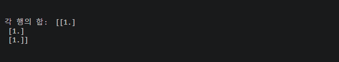

## 문제 3

### 3.1 코드

```
a = np.random.randn(5)
b = np.random.randn(5, 1)
print("a.shape: " ,a.shape , "b.shape: ", b.shape)
print("a.T.shape: " ,a.T.shape , "b.T.shape: ", b.T.shape)
print("np.dot(a, a.T): ",np.dot(a, a.T),"np.dot(b, b.T): ", np.dot(b, b.T))
```

### 3.2 a,b shape

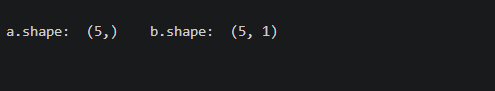

### 3.3 a.T.shape , b.T.shape

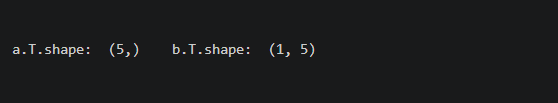

**a.T.shape가 a.shape와 동일한 이유**

선형대수학에서는 전치를 진행하게 된다면 행과 열이 바뀌어야 하지만
numpy에서 전치를 진행하면 (5,) 그대로 나오게 되게 된다. <br>이는 넘파이 1차원 배열은 행과 열이 정의 되지않기에
정확히 애기하면 축이 1개 이기에 변환이 되지 않는다. 
<br>
하지만 2차원 행렬의 경우 축이 두개 이기에 두 축을 변화이 가능하다 따라서 전치를 진행하면 (5,1) 차원이 (1,5)로 변환된다.

### 3.4.1 dot(a,a.T) 

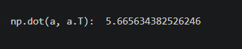


### 3.4.2 dot(b,b.T) 

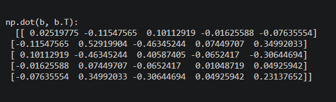

**dot(a,a.T) 와 dot(b,b.T) 가 다른 이유**

선형대수학에서 백터를 열 백터로 정의하면 a*a.T는 외적으로 정의 되며 반대로 행 백터이면 a * a.T는 내적으로 정의된다. <br><br>
하지만 넘파이에서는 1차원 배열은 행과 열이 없다.  따라서 넘파이의 dot 함수에서 1차원 배열간에 곱셉은, <br>
전부 내적으로 정의하여 a.a.T는 스칼라 값이 나오게 된다.<br><br>
b는 (5,1)이기에 열 백터 행태를 가진다. 따라서 전치하면 (1,5)가 되어 np.dot(b, b.T)는 ,(5,1) * (1,5)의 행렬 곱셈을 수행한다.<br> 이는 선형대수학에서의 외적과 동일하다.<br>

<br>

### 3.5 어떤 배열 형태가 적합한가?

2차원 배열은 선형대수학에서 행과 열을 명확하게 구분해야 하는 연산(예: 전치)이나 행렬 곱셈의 결과 Shape을 <br>명시적으로 표현하고자 할 때 사용하는 것이 적절하다. <br><br>
1차원 배열은 여러 샘플에 대한 한 개의 특성을 저장하거나 한 샘플에 대한 여러 특성을 저장하여 보여줄 때 사용한다.<br>예를 들어 Matplotlib의 plot 처럼 각 축을 따로 지정할 때 1차원 배열로  x는 -5부터 5까지 일정한 간격으로 <br>증가하는 값들을 지정하고 y 축은 sin 값으로 사용한다. <br><br>
따라서 연산의 목적과 필요한 Shape에 따라 1차원 배열과 2차원 배열을 선택하는 것이 적절하다.

<br><br>

## 문제 4

### 4.1  relu 함수가 꺽이는 위치 


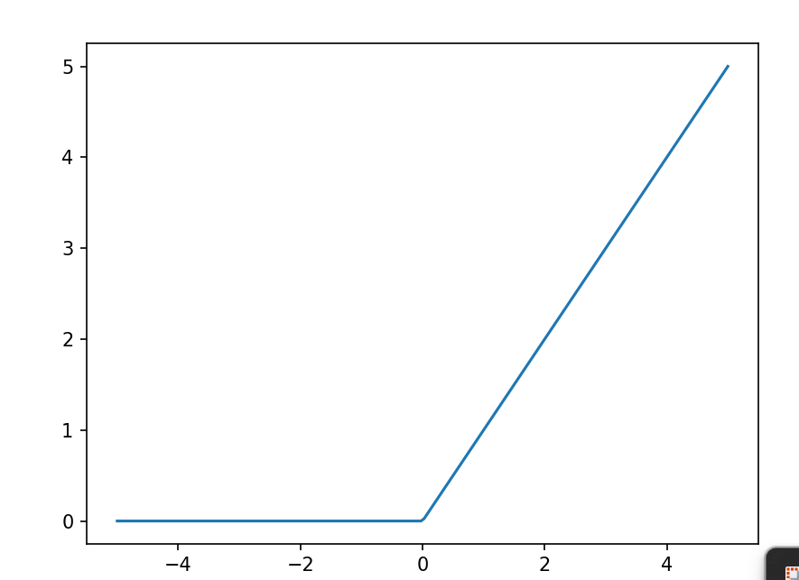


**relu 함수의 꺽이는 위치의 식**

relu 함수는 y값이 0이 되는 지점에서 꺽이게 된다. relu는 활성화 함수로 사용될 때 식은 다음과 같다.

$$
y = \mathrm{ReLU}(wx+b)
$$

여기서 relu는 w*x + b이 0이 되는 지점에서 꺽이기에 다음과 같이 전개하여 0이 되는 x 지점을 구할 수 있다

$$
wx+b=0
$$

$$
x=-\frac{b}{w}
$$

<br>

### 4.2 꺽이는 지점 표시

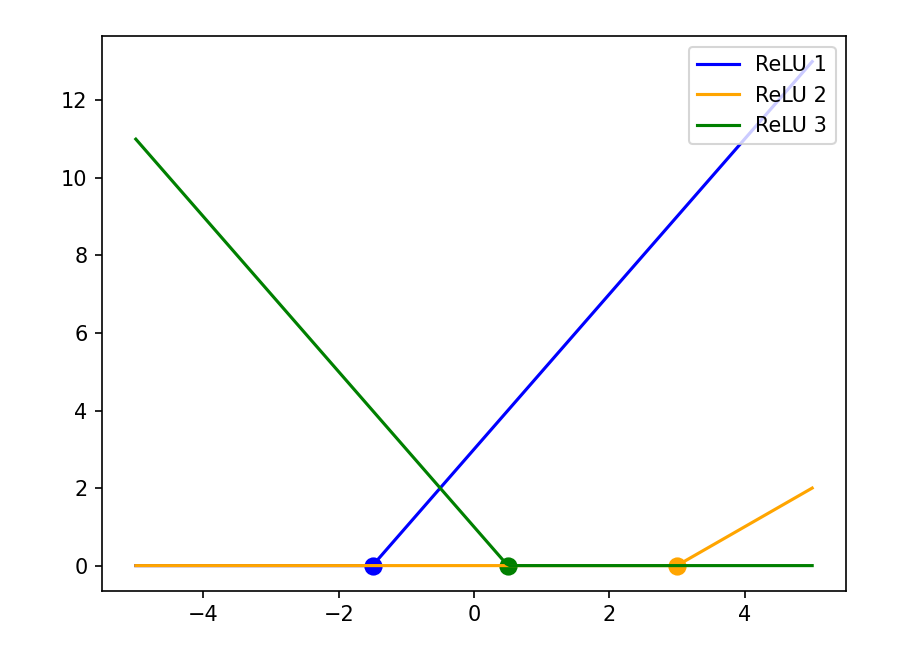

<br>

**그래프 상에서 꺽이는 위치** 

그래프에서 파란 색은 w=2,b=3이기에 꺽이는 지점은 -3/2이며, 노란색은 w=1 b=-3으로 꺽이는 지점은 3이다<br>
마지막으로 초록색은 w=-2 b=1로 꺽이는 지점은 1/2이다.

<br>

### 4.3 relu 3개 더한 그래프

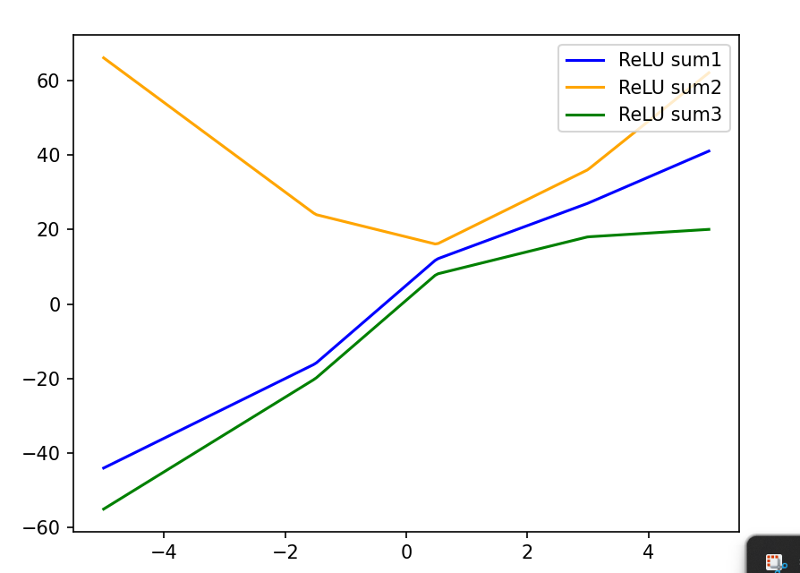


### 4.4 relu 합 100 그림

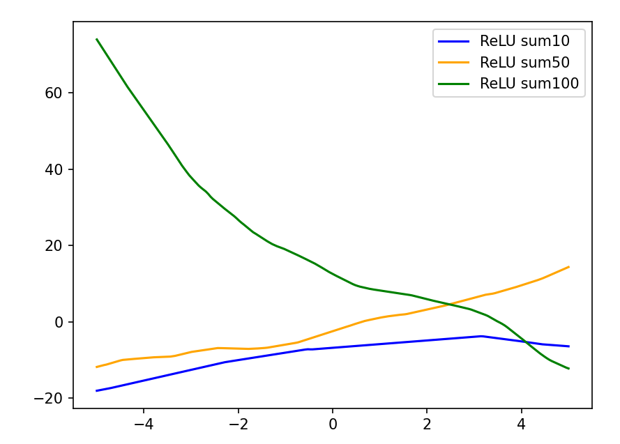

**relu함수 값을 더하면 비선형 함수가 나오는 이유**

relu 함수 자체는 두개의 직선 함수가 결합되어 기울기가 두 구간에서 다르기에 비선형 함수라고 할 수 있다. <br>
따라서 수치적으로 다른 relu 함수들을 여러개 더한 결과는 기울기가 변화하는 지점이 여러 구간에서 존재하는 함수이다.<br> 
이렇게 relu함수를 합 한 함수는 기울기가 계속 변화할 수 있게 되면서 다양한 비선형 함수의 형태 표현할 수 있게 된다.

<br>


### 4.5 linear sum 그림

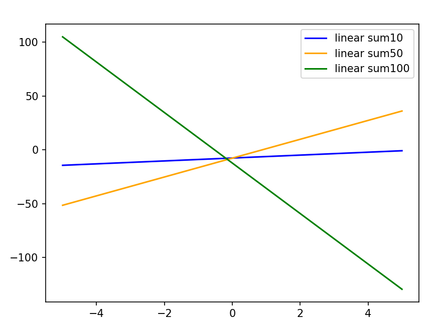

**선형 함수는 값을 더해도 선형 함수이다**

linear 함수 자체를 여러번 더해도 결국 선형성을 띄기에 직선 형태를 가진다. <br>
이는 선형 함수는 기울기가 변화하는 구간이 없기에 그 기울기가 계속 유지되게 되면서 직선의 성질을 가지게 된다.<br>
또한 선형대수학 적으로는 여러 개의 행렬은 선형적인 변환으로 이를 무한히 더하여도 결국에는 행렬 형태로 존재하게 된다.
따라서 선형 변환만을 반복해서 사용하면 비선형 변환을 표현할 수 없으며, 이를 해결하기 위해 ReLU와 같은 비선형 활성화 함수가 필요하다.

<br>


### 4.6 활성화 함수의 역활

활성화 함수는 비선형적인 표현을 만드는 역활을 수행한다. <br>
이를 좀 더 자세히 설명한다면 신경망은 여러 개의 층을 쌓아 이를 바탕으로 다양한 표현을 근사하고자 한다.<br>
하지만 신경망 상에서의 가중치값들만을 곱하게 된다면 y=wx+b 형태의 선형적인 함수를 가지게 되어 비선형적인 표현을 하지 못하게 된다.<br>
따라서 비선형성을 가지게 하기 위해서 sigmoid , relu를 활성화 함수로 사용하여 신경망이 비선형적인 표현을 만들수 있게 한다.

<br>

## 문제 5

### 5.1 np.linalg.lstsq()란? 

최소자승법(Least Squares)은 어떠한 함수 또는 모델을 데이터 세트에 맞추는 기법이라고 할 수 있다. <br>
오차란 데이터와 추정된 값의 차이로 이 오차값이 최소화하는 x를 찾는 것을 최소자승법이라고 할 수 있다.
이는 선형대수학적으로 풀 수 있으며 np.linalg.lstsq는 이를 svd를 통해서 최소자승법 문제를 푼다. 

### 5.2 n에 따른 y_pred 
<br>

**n=5일 때 y_pred**

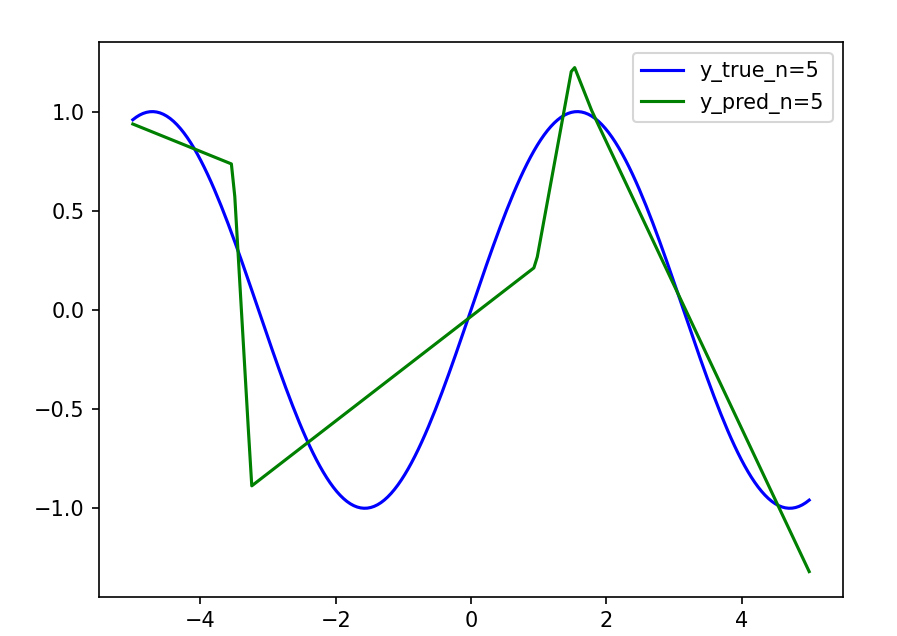

<br><br>

**n=20일 때 y_pred**

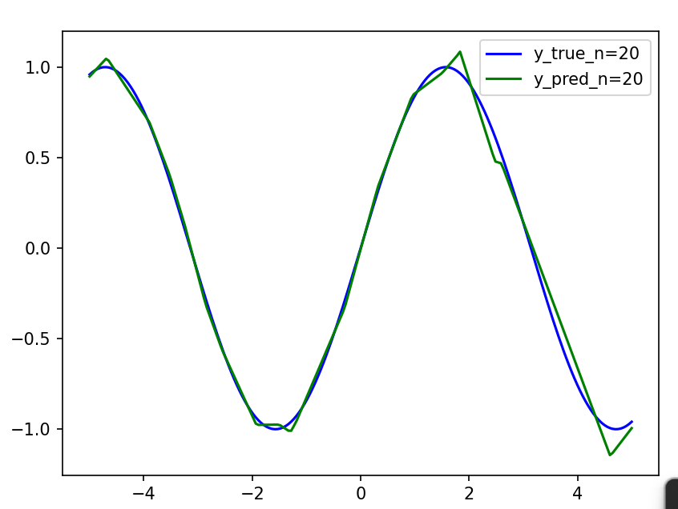

<br><br>

**n=100일 때 y_pred**

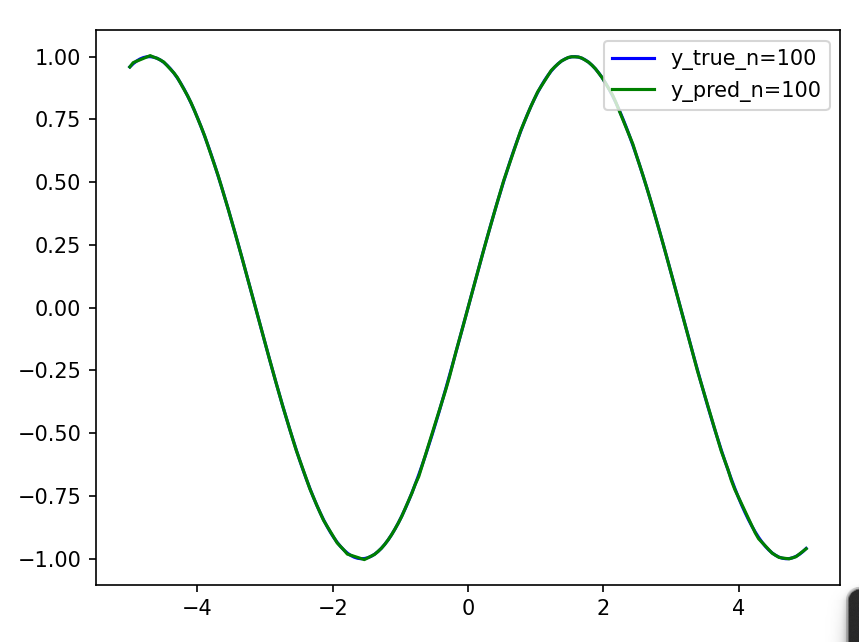


**n이 증가할 때 y_pred**


n이 증가할 수록 c에 값으로 y_pred는 y_true와 근사 되게 된다. 

이는 하나의 x에 대한 n개의 relu값의 비중 값인 c를  np.linalg.lstsq로 알아낼 수 있어,<br> n이 커질수록 활용 가능한
값이 많지게 되어 점점 y_true에 근사할 수 있게 된다. 

### 5.3 n에 따른 mse값 

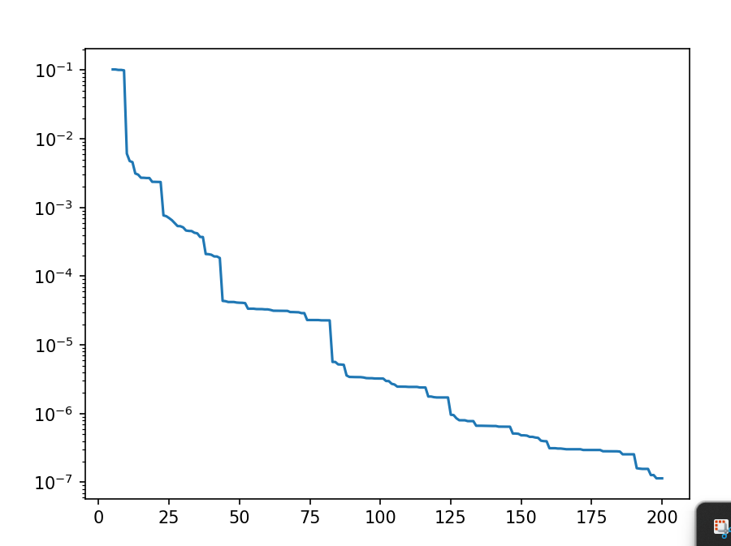

**n에 따른 오차의 양상**

n이 커질수록 오차가 작아지는 현상을 가진다. 이는 앞서 말했듯이  n이 커질수록 활용 가능한<br>
값이 많지게 되어 점점 오차가 내려가여 거의 동일하진다고 할 수 있다 여기서 y는 log 스케일로 ,<br>
n이 커질 때마다 일정하게 감소하는 것이 아닌 어떤 구간에서는 급격하게 , 어떤 구간에서는 완만하게 감소하게 된다.

### 5.4 실제 신경망 학습과 차이

실제 신경망의 경우 w,b를 gradient descent로 하여 least Squares를 구하게 된다. <br>
이를 통해 relu 함수를 더하여  만들어지는 최종 함수는 다양한 비선형 함수로 표현될 수 있다는 장점을 가지게 된다. <br><br>
np.linalg.lstsq()는 w,b를 고정한 뒤 활성화 함수의 값에 곱하는 c를 선형 문제로 하여 구하게 된다. <br>
이 방법은 w, b를 고정하여 각 relu의 꺽이는 위치가 고정되어 있으며 각 꺽이는 점의 정도를 <br>c로 인한 선형 결합으로 조절하여 여러 형태를 표현한다. <br><br>따라서 랜덤한 꺽이는 지점에서의 기울기를 조절 가능하기에 relu함수가 많아야 복잡한 비선형 함수를 표현 가능하다는 단점을 가진다. 

## 막혔던 것 

- ### 증상

여러 ReLU 함수를 합산하는 실험에서 각 ReLU 함수의 꺾이는 위치를 -5에서 5 사이로 설정하는 과정에서,<br>
처음에는 Min-Max 정규화를 이용하여 값을 조절하려 했으나, 결과는 밋밋한 직선에 가까운 함수가 나왔다.

- ### 원인

ReLU 함수는 입력값 wx+b가 0이 되는 지점에서 기울기가 변한다.

따라서 꺾이는 지점은 x = -b/w로 결정된다. 단순히 가중치와 편향의 값을 정규화하는 것만으로는 이 비율이 원하는 범위에 들어가도록 보장할 수 없었다.

- ### 해결

가중치와 편향을 먼저 설정하는 대신, ReLU 함수가 꺾이는 위치를 먼저 지정하는 방식으로 변경하였다.

r = np.random.uniform(-5, 5, relu_number)를 이용하여 꺾이는 위치를 -5에서 5 사이에서 무작위로 생성하였다.

이후 w = np.random.randn(relu_number)로 가중치를 생성하고, b = -w * r을 이용하여 편향을 계산하였다.

이는 꺾이는 위치를 결정하는 식 r = -b/w를 편향에 대해 정리한 것이다.

따라서 각 ReLU 함수의 꺾이는 위치를 원하는 구간에 직접 설정할 수 있었다.

## 아직 모르겠는 것

해결은 하였지만 왜 아직 Min-Max 정규화를 이용하여 값을 조절하여서 꺽이는 지점을 조절하였을 때,<br>
밋밋하게 나오는 지를 명확하게 이해하지 못하였다. 

또한 mse 에서 특정 구간에서 완만하게 감소하는데 이를 직관적으로는 이유를 알지만 명확하게 분석할 방법은 아직 찾지 못하였다.