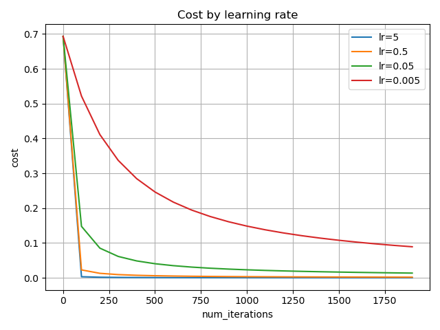
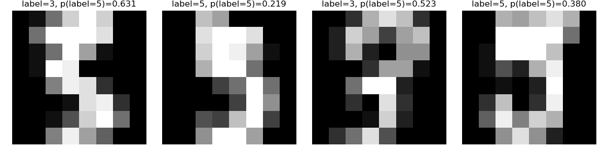

# logistic regresssion

## 1. 구현 요약

NumPy를 사용하여 로지스틱 회귀의 순전파와 역전파를 직접 구현하고 검증하였다.<br>
이를 통해 예측값으로부터 비용과 기울기를 계산하고, 가중치와 편향이 갱신되는 학습 과정 전반을 이해하였다.

## 2. 수식 유도 

**순전파**

- 데이터셋의 형태 

$$
{\Large X \in \mathbb{R}^{n \times m}, \quad Y \in \mathbb{R}^{1 \times m}}
$$

- Z

$$
{ \Large Z= w^TX +B; \quad w \in \mathbb{R}^{n\times 1}, B \in \mathbb{R^{1\times m}}}
$$


- A

$$
{\Large A =  \sigma(Z) ; \quad where \quad \sigma(z) = \frac{1}{1+e^-{z}}}
$$

- J(W,B)

$$
{\Large J(W,B)= -\frac{1}{m}  \sum_{i=1}^{m} \left[y^{(i)}\log a^{(i)} +(1-y^{(i)})\log(1-a^{(i)})\right]}
$$

**역전파**

- $\Large da$

$$
{\Large da=\frac{d L}{d a} 
     = -( y \times \frac{1}{a} - (1-y) \times \frac{1}{1-a})=\frac{a-y}{a(1-a)}}
$$


- $\Large  dz$


```math
{\Large
\begin{aligned}
&\frac{da}{dz} = \frac{e^{-z}}{(1+e^{-z})^2}
= a(1-a)\\
&\rule{0pt}{0.5em}\\
&\begin{aligned}
dz:=\frac{dL}{dz}
&= \frac{dL}{da}\frac{da}{dz}\\
&= \frac{a-y}{a(1-a)}\,a(1-a)\\
&= a-y
\end{aligned}
\end{aligned}
}
```


**$\Large dw ,dw$**

- dZ

$$
{\Large dZ= [dz^{(1)},\ldots,dz^{(m)}]=A-Y}
$$

- dw 식

$$
{\Large
\begin{aligned}
dw =\frac{1}{m}XdZ^T \\
&\rule{0pt}{0.5em}\\
{\Large dw \in \mathbb{R}^{n \times 1}}
\end{aligned}
}
$$


- db 식


$$
{\Large
\begin{aligned}
db =\frac{1}{m}\sum _i ^m dZ \\
&\rule{0pt}{0.5em}\\
{\Large db \in \mathbb{R}}
\end{aligned}
}
$$


## 3. 검증 결과


### 3.1 sigmoid 오버플로우 경고

**원인**

sigmoid에서 오버플로우 경고는 $e^-z$ 에서 z값이 음수 상황에서 값이 클 경우에 발생하게 된다. 


<br>

**해결방법**

이를 해결하고자 음수 일때는 $e^z$ 형태로 계산하여 큰값이 반환이 되지 않게 계산을 진행한다. <br>

식은 다음과 같다. 

$$
{\Large \sigma(z)=
\begin{cases}
\frac{1}{1+e^{-z}}, & z \ge 0 \\
\frac{e^z}{1+e^z}, & z < 0
\end{cases}}
$$


<br>

**결과**


코드 
<br>

```
def sigmoid(z):
    #예상 입력: z=(1,m)
    z=np.array(z)
    A=np.zeros_like(z, dtype=float)
    positive = (z >= 0)
    
    A[positive]=1 / (1 + np.exp(-z[positive]))

    exp_z = np.exp(z[~positive])
    A[~positive] = exp_z / (1 + exp_z)

    return A #출력 A.shape=(1,m)

overflow_debug=sigmoid(np.array([-1000, 0, 1000]))
print("시그모이드 오버플로우 검증 "overflow_debug)
```

실행결과 

<br>

> 시그모이드 오버플로우 검증:  [0.  0.5 1. ]


<hr>

### 3.2 비용함수 안정성 문제


**원인**


시그모이드 출력이 정확히 0 또는 1이면 비용 계산에서 log(0)이 발생한다. 이때 생성된 -inf에 0이 곱해지면 nan이 발생할 수 있다.

<br>

**해결방법**


정확히 0인 값은 1e-15, 정확히 1인 값은 1-1e-7로 변경하여 로그의 입력이 0이 되지 않도록 하였다.

이는 비용함수 계산 과정에서의 오차로 하고자 복사본으로 진행하였다. 

따라서 원래 예측값은 변경하지 않아 역전파 계산에 영향을 주지 않도록 않게 된다..


<br>

**결과**


코드 
<br>

```
Y_debug = np.array([[0, 1]])

A_debug = sigmoid(Y_debug)

cost_debug = cost_function(
     A_debug, Y_debug, Y_debug.shape[1]
)
               
print("cost:", cost_debug)
print("NaN 포함:", np.isnan(cost_debug).any())
print("Inf 포함:", np.isinf(cost_debug).any())
```

<br>


실행 결과 
> cost: 0.503204434039084
> NaN 포함: False
> Inf 포함: False


<hr>


### 3.3 기울기 검증 상대 오차 


**0으로 초기화 시킨 w,b**

```
w,b=initialize(X_train.shape[0])
print("0으로 초기화: ",gradient_checks_test(X_train,Y_train,w,b))
```
<br>

실행결과

> 0으로 초기화:  1.0635658133919565e-09

<br>


**무작위 값으로 초기화 시킨 w,b**


```
w=w = np.random.rand(64, 1)
b=np.random.rand()

print("무작위 값으로 초기화: ",gradient_checks_test(X_train,Y_train,w,b))
```
<br>

실행결과

> 무작위 값으로 초기화:  1.0031697790993992e-05


<hr>

### 3.4 기울기 검증기 디버깅


| `방법` | `상대오차` |
| :---: | :---: |
| 정상 | 1.0635658133919565e-09 |
| dw = XdZ.T | 0.8158047700826827|
| db= + 1/m*dZ | 0.2361218188947964 |
| dw = XdZ.T * 2 | 0.32853597746537044 |


<hr>

### 3.5 비용함수 곡선


<hr>

### 3.6 train / test 정확도 


**코드**


```
result = model(X_train, Y_train, X_test, Y_test)

print(f"훈련 정확도: {result['train_accuracy']:.2%}")
print(f"테스트 정확도: {result['test_accuracy']:.2%}")
```

<br>

**실행결과**


> 훈련 정확도: 100.00%
> 테스트 정확도: 100.00%

<br>

## 4. 추가 실험 1 




**각 학습률별 양샹**

학습률이 0.005일 때는 매우 완만한 곡선 형상을 갖으며 다른 학습률보다 전체구간에서 가장 높은 비용 값을 가졌다.<br> 학습률이 0.05일 때는 0.005일 때와 달리 초반 부분에서 빠르게 감소하며 이후에는 감소 폭이 작아지는 현상을 보인다.<br> 
학습률이 0.5일 때는 초기 구간에서 급격히 감소한 뒤 완만하게 감소한다.<br> 
학습률이 5일 때는 가장 빠르게 감소한 뒤 이후 그래프상 비용 값의 변화가 거의 없는 현상을 가진다.

## 5. 추가 실험 2


| `문제` | `train 정확도` | `test 정확도` |
| :---: | :---: | :---: |
| 라벨 0,1 | 100% | 100% | 
| 라벨 3,5 | 99.32% | 97.26% | 

**달라진 점**

0,1일 때는 train ,test 데이터셋 모두에서 100%의 정확도를 기록하였지만 라벨이 3,5으로 변경되면서 정확도가 내려갔다.


## 6. 추가 실험 3




**틀린 사례에 대한 비교**

3번째 사진을 제외한 나머지 사진의 경우 획이 뭉쳐지거나 명확하지 않아 사람이 봐도 3인지 5인지 구분하기 어려웠다.<br>
세 번째 사진은 전체적으로 3의 형태를 보이지만 획이 흐릿하다. 이러한 불명확한 형태가 모델의 오분류에 영향을 주었을 것으로 추측한다.

## 막혔던 것

**증상**

```
 Z=w.T* X + b
      ~~~^~~
ValueError: operands could not be broadcast together with shapes (1,64) (64,2

```
<br>

**원인**

NumPy의 원소별 곱셈 *과 행렬 곱셈 @를 혼동하였다. <br>
입력 데이터는 이미지 한 장이 열에 배치된 (64, 288) 형태였으며, 각 이미지의 픽셀값과 가중치를 곱한 뒤 합산해야 했다.

<br>

**해결**

*를 @로 변경하여 행렬 곱셈을 수행하였다. <br>
그 결과 (1, 64) @ (64, 288) 연산으로 각 이미지에 대응하는 값 하나씩, 총 (1, 288) 형태의 Z를 계산할 수 있었다

## 아직 모르겠는 것