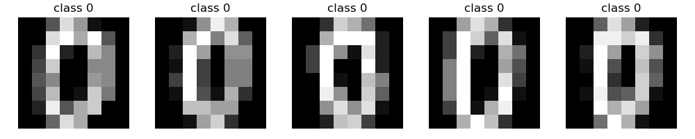
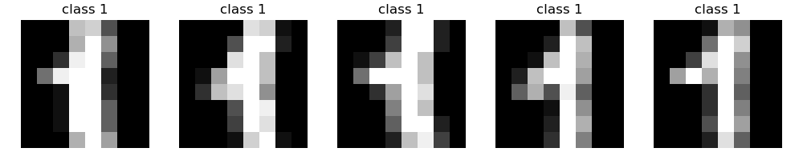

# logistic regresssion

## 1. 데이터 준비 

### 1.1 각 라벨별 데이터 그림

**라벨 0**



**라벨 1**



### 1.2 데이터셋 차원 

**코드**

```
print("X_train.shape: ",X_train.shape ,"X_train의 최솟값: ",X_train.min() , " X_train_최대값: ", X_train.max())
print("Y_train의 값 종류: ",np.unique(Y_train))
```

**X_train**
> X_train.shape:  (64, 288) X_train의 최솟값:  0.0  X_train_최대값:  1.0

**Y_train**
> Y_train의 값 종류:  [0 1]


## 2. 수식 유도 

**순전파**

- 데이터셋의 형태 

$$
{\Large X \in \mathbb{R}^{n \times m}, \quad Y \in \mathbb{R}^{1 \times m}}
$$

- Z

$$
{ \Large Z= w^TX +B; \quad w \in \mathbb{R}^{n\times 1}, B \in \mathbb{R^{1\times m}}}
$$


- A

$$
{\Large A =  \sigma(Z) ; \quad where \quad \sigma(z) = \frac{1}{1+e^-{z}}}
$$

- J(W,B)

$$
{\Large J(W,B)= -\frac{1}{m}  \sum_{i=1}^{m} \left[y^{(i)}\log a^{(i)} +(1-y^{(i)})\log(1-a^{(i)})\right]}
$$

**역전파**

- $\Large da$

$$
{\Large da=\frac{d L}{d a} 
     = -( y \times \frac{1}{a} - (1-y) \times \frac{1}{1-a})=\frac{a-y}{a(1-a)}}
$$


- $\Large  dz$


```math
{\Large
\begin{aligned}
&\frac{da}{dz} = \frac{e^{-z}}{(1+e^{-z})^2}
= a(1-a)\\
&\rule{0pt}{0.5em}\\
&\begin{aligned}
dz:=\frac{dL}{dz}
&= \frac{dL}{da}\frac{da}{dz}\\
&= \frac{a-y}{a(1-a)}\,a(1-a)\\
&= a-y
\end{aligned}
\end{aligned}
}
```


**$\Large dw ,dw$**

- dZ

$$
{\Large dZ= [dz^{(1)},\ldots,dz^{(m)}]=A-Y}
$$

- dw 식

$$
{\Large
\begin{aligned}
dw =\frac{1}{m}XdZ^T \\
&\rule{0pt}{0.5em}\\
{\Large dw \in \mathbb{R}^{n \times 1}}
\end{aligned}
}
$$


- db 식


$$
{\Large
\begin{aligned}
db =\frac{1}{m}\sum _i ^m dZ \\
&\rule{0pt}{0.5em}\\
{\Large db \in \mathbb{R}}
\end{aligned}
}
$$


