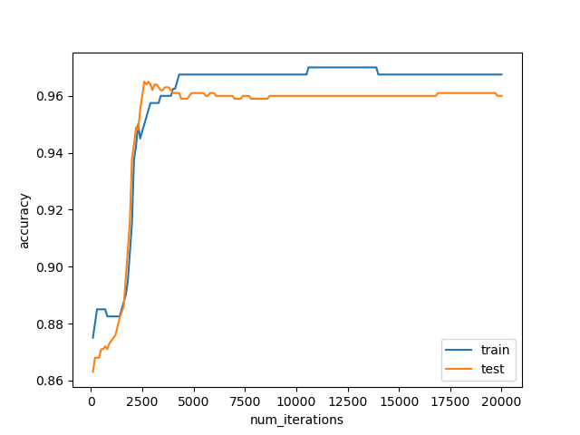
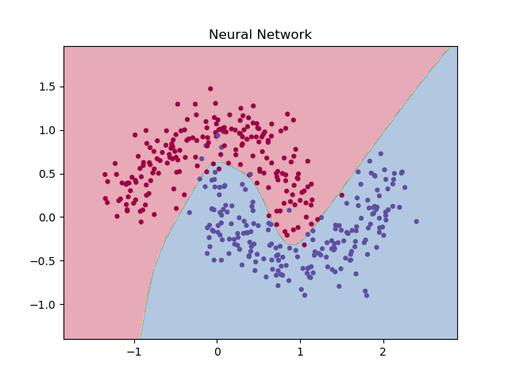
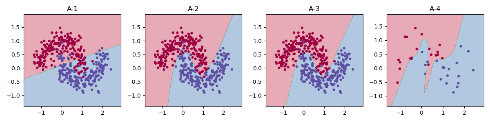
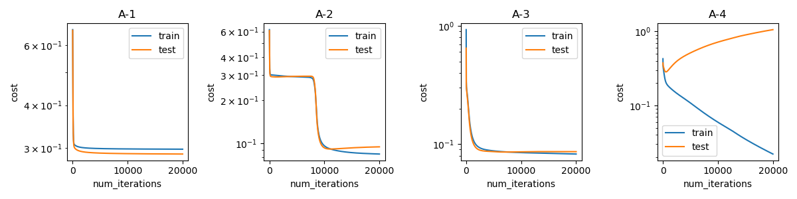
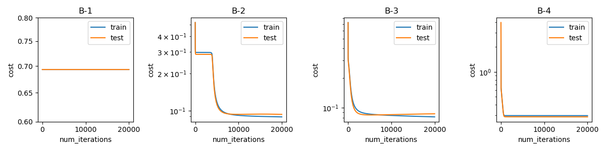
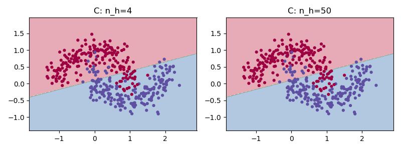
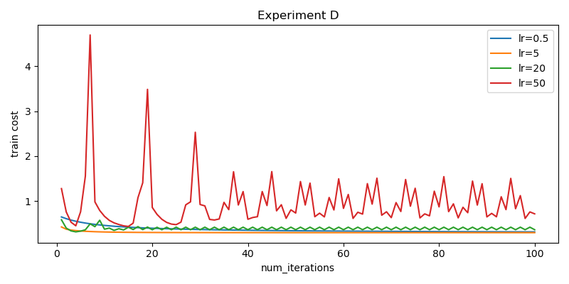

# Shallow neural network

## 1. 구현 요약 

곡선 함수를 구현하는 데이터셋을 기반으로 얇은 신경망과 로지스틱 회귀의 성능차이를 검증하며 
이전 과제에서의 손실함수 값을 다시 검증하였다. 

## 2. 수식 유도 

**손실 함수**

- $\log \hat y   $

```math
\begin{aligned}
\log\hat y

&=\log e^z-\log(1+e^z)\
&=z-\log(1+e^z)
\end{aligned}
```

- $\log 1- \hat y$ 

```math
\log(1-\hat y) -\log(1+e^z)

```

- 최종 식 

```math

\begin{aligned}
-\left[y\log\hat y+(1-y)\log(1-\hat y)\right]
&=-\left[y\{z-\log(1+e^z)\}
       -(1-y)\log(1+e^z)\right]\\
&=\log(1+e^z)-yz
\end{aligned}

```

**역전파**

- $dZ^{[2]}$

```math

dZ^{[2]}=A^{[2]} -Y

```

- $dW^{[2]} ,\quad db^{[2]}$

```math
\begin{aligned}
dW^{[2]}=\frac{1}{m}dZ^{[2]}A^{[1]T}\\
db^{[2]}= \frac{1}{m} \sum _i ^m dZ^{[2]}
\end{aligned}
```

- $dZ^{[1]}$

```math

dZ^{[1]}=\frac{\partial\mathcal L}{\partial Z^{[1]}}
=

\frac{\partial\mathcal L}{\partial Z^{[2]}}
\frac{\partial Z^{[2]}}{\partial A^{[1]}}
\frac{\partial A^{[1]}}{\partial Z^{[1]}}

```

```math


\frac{\partial\mathcal L}{\partial Z^{[2]}}
=dZ^{[2]} ,\quad 

\frac{\partial Z^{[2]}}{\partial A^{[1]}}
= W^{[2]} ,\quad 
\frac{\partial A^{[1]}}{\partial Z^{[1]}}
=1-(A^{[1]})^2

```

```math

dZ^{[1]}
=
\left((W^{[2]})^TdZ^{[2]}\right)
*
1-(A^{[1]})^2

```

- $dW^{[1]} ,\quad db^{[1]}$

```math
\begin{aligned}
dW^{[1]}=\frac{1}{m}dZ^{[1]}X^T
\\
db^{[1]}=\frac{1}{m}\sum _i ^m dZ^{[1]}
\end{aligned}
```


## 3. 구현 검증 결과

### 3.1 기울기 검증 상대 오차

**n_h=4**

코드 

```
parameters=initialize_parameters(X_train.shape[0],4,Y_train.shape[0])
error_nh_4=gradient_checks_test(X_train,Y_train,parameters)

print("n_h=4 기울기 오차: ", error_nh_4)
```


결과
> n_h=4 기울기 오차:  4.555480444964085e-11

**n_h=50**

코드 

```
parameters=initialize_parameters(X_train.shape[0],50,Y_train.shape[0])
error_nh_50=gradient_checks_test(X_train,Y_train,parameters)

print("n_h=50 기울기 오차: ", error_nh_50)
```

결과
> n_h=50 기울기 오차:  2.985529073064345e-11

<hr>

### 3.2 n_h=4 시험 정확도



<hr>

### 3.3 결정 경계




## 4. 로지스틱 회귀의 실패 

**시험 정확도**

코드 

```
predict_test=predict_fn(X_test)
test_accuracy=np.mean(predict_test == Y_test)
print("시험 정확도: ",test_accuracy)
```

결과 
> 시험 정확도:  0.862

<hr>

**로지스틱 회귀 결정 경계**


**무엇이 문제인가?**

로지스틱 회귀의 경우 은닉층이 없다. <br>
이는 은닉층에서 출력층 사이의 비선형 함수층이 없어 선형 결합만으로 결정 경계를 형성하게 되어 
직선형태로 만들어지게 된다. <br>
따라서 정확도가 일정 이상 형성되지 못한다.  

## 5. 실험 A

**정리 표**

| 실험 | 학습 정확도 | 시험 정확도 | 최종 학습 비용 | 최종 시험 비용 | 최소 시험 비용 | 최소 비용 반복 | 상승폭 | 판정 |
|---|---:|---:|---:|---:|---:|---:|---:|---:|
| A-1 | 87.75% | 86.40% | 0.297467 | 0.287916 | 0.287916 | 20,000 | 0.000000 | 과소 적합 |
| A-2 | 96.25% | 95.90% | 0.084562 | 0.094869 | 0.091597 | 11,141 | 0.003272 | 정상 |
| A-3 | 97.25% | 96.30% | 0.082535 | 0.086436 | 0.085794 | 7,068 | 0.000643 | 정상 |
| A-4 | 100.00% | 84.90% | 0.022079 | 1.058637 | 0.284483 | 542 | 0.774154 | 과적합 |

<hr>

**뚜렷하게 기준**

과적합이 나오는 기준은 이 둘의 격차가 급격하게 커지는 것을 기준으로 잡았다. <BR>
정확하게는 A-2의 경우에는 0.003으로 경미한 차이가 할 수 있지만 0.77로 0.1 이상이 낫기에 A-4를 과적합으로 하였다.


<hr>

**그래프**

결정 경계



손실 곡선



<hr>

**과적합 설명**

- A-2과 A-3 비교 

A-2와 A-3는 비슷하지만 A-3가 약간 높은 정확도를 가지게 된다. 이는 A-3의 결정 경계가 좀 더 곡률이 높은 곡선을 <br> 전가지게 되어 정확도가 약간 높지만 경계 함수 형상이 비슷하기에 약간의 차이만 존재한다.  <BR>

하지만 손실곡선과 결정 경계를 보면 차별점이 존재하게 된다. <BR>
A-2의 경우 처음에는 높은 손실을 가지지만 A-3의 경우 값이 처음부터 작으며 빠르게 수렵하게 된다.

- A-3와 A-4 비교 

데이터량이 작아지게 되면서 데이터 분포안에 노이즈 까지 학습하게 되면서 A-4에서 과적합 현상이 일어나게 되었다.

- 과적합이란? 

과적합은 모델의 표현력과 학습 데이터의 양·잡음·대표성 사이의 관계에서, 모델이 학습 표본의 노이즈까지 <BR>
표현하게 되어 새로운 데이터에 대한 일반화 성능이 나빠지는 것을 말한다.

- A-2는 과적합인가?

A-2의 경우에는 최대 - 최소의 차이가 0.003으로 차이 값이 커지지 않지만 손실곡선을 보면 <BR>
계속 올라가고 있기에 이후 학습을 계속 진행하게 된다면 충분한 과적합이 나올 가능성이 있다.

## 6. 실험 B


**결과 표**

| 실험 | 서로 다른 은닉 유닛 수(W1) | 서로 다른 은닉 유닛 수(W2) | 시험 정확도 |
|---|---:|---:|---:|
| B-1 | 1개 | 1개 | 50.0% |
| B-2 | 50개 | 50개 | 96.2% |
| B-3 | 50개 | 50개 | 96.3% |
| B-4 | 1개 | 1개 | 86.3% |

<hr>

**손실 곡선**



<hr>

**대칭성 문제**

- 왜 B-1에서 w1의 정확도는 50%이며 이는 유닛 규모를 늘려 해결 가능한가?

정확도가 50%인 이유는 A값이 0.5로 출력 되어 모든 입력에 대해서 한 클래스로 예측하기 때문이다.<BR>
이는 유닛 규모를 늘려도 동일한 문제로 손실 곡선을 확인 하면 알 수 있듯 학습 자체가 성립하지 않는다.

- 왜 B-1에서 W1과 W2는 움직이지 않는가?

```math
A_1=0
\quad\Rightarrow\quad
dW_2=\frac1m dZ_2A_1^\top=0
\\
W_2=0
\quad\Rightarrow\quad
dZ_1=(W_2^\top dZ_2)\odot(1-A_1^2)=0
\quad\Rightarrow\quad dW_1=0
```

B-1에서는 은닉층 출력이 0이므로 dW2가 0이고, W2도 0이므로 은닉층으로 전달되는 dZ1과 dW1도 0이다. <br>
따라서 두 가중치 모두 갱신되지 않게 되어 학습 곡선이 일정한 값을 가지게 된다.


- B-2의 경우 

B-2에서는 W2가 난수로 초기화되어 유닛마다 서로 다르다. <br>
따라서 W1이 모두 0이어도 dZ1 = W2.T @ dZ2를 통해 각 유닛에 서로 다른 기울기가 전달되어 W1이 다르게 갱신된다. <br>
이후 은닉층 출력이 달라지면서 W2도 학습된다.


- B-4의 경우 

B-4에서는 모든 은닉 유닛이 동일한 파라미터로 시작하므로 같은 기울기로 갱신된다. <br>
따라서 학습 중에도 유닛 간 대칭성으로  여러 유닛이 하나의 은닉 유닛처럼 동작한다. <br>
그 결과 A-1과 같이 , 직선 형태의 결정 경계를 만들어 비슷한 정확도를 보인다.


## 7. 실험 C

**결과 표**

| 실험 | 은닉 유닛 수 | 시험 정확도 |
|---|---:|---:|
| C-1 | 4개 | 86.3% |
| C-2 | 50개 | 86.3% |

**결정 경계**



**왜 직선인가?**

은닉층에 비선형 활성화 함수가 없으면 두 층의 연산이 하나의 선형식으로 합쳐지므로, 결정경계는 직선이 된다.

```math

\begin{aligned}
A_1 &= Z_1 = W_1x+b_1 \\[12pt]
z_2 &= W_2A_1+b_2 \\
    &= W_2(W_1x+b_1)+b_2 \\
    &= (W_2W_1)x+(W_2b_1+b_2) \\[12pt]
z_2 &= \widetilde W x+\widetilde b
\end{aligned}
```

## 8. 실험 D

**손실 곡선**




**원인 분석**

숫자 0·1 데이터에서는 큰 학습률에서도 학습 비용이 안정적으로 감소한 반면, <br>
초승달 데이터에서는 학습률 20과 50에서 비용이 진동하는 현상이 관찰되었다. <br>

숫자 0·1은 로지스틱 회귀의 선형 경계로 잘 구분되는 데이터이므로, 계속 오차를 줄일 수 있어<br>
학습이 진행되면서 비용함수가 평평해지는 현상을 관측할 수 있다. <br>

반면 초승달 데이터는 선형 경계로 충분히 분리하기 어렵다.<br> 그래선 학습을 진행하면서 계속 적으로 
오차를 줄일 수 없고 그 사이에서 근사해를 찾기에 학습률이 높을 수록 진동하게 된다.

따라서 모델이 학습하기 쉬운 데이터의 경우 학습 수렴하기 좋아 학습률이 높아도 상관없지만 <br>
데이터가 어려운 경우 학습률이 높아질 수록 수렵하기 어려운 경향성을 가지게 된다. 

<hr>

**헤시안 값 분석**

> 학습률: 0.5, L: 0.139453, 2/L: 14.341781<br>
> 학습률: 5, L: 0.139451, 2/L: 14.341985<br>
> 학습률: 20, L: 0.159803, 2/L: 12.515414<br>
> 학습률: 50, L: 0.089223, 2/L: 22.415670

안정적이기에 수렵된 0.5와 5에서의 2/L(임계값)은 14가 나왔다. <BR>
이를 기반으로 다시 손실곡선을 분석 해본 결과  학습률이 14를 <BR>
넘어갈 경우 진동하는 현상을 확인할 수 있었다. 

## 막혔던 것

**증상**

기울기 검증 과정에서 예상보다 큰 상대 오차가 발생하였다.

> n_h=4 기울기 오차: 1.354e-07 

또한 학습 및 시험 그래프 상에서 모든 그래프의 첫번째 부터 test 손실 곡선이 낮아지는 것이 수상해서 이를 조사하였다. 


**원인** 

기울기 검증 상에서의 오차의 경우  너무 작은 앱실론 값을 사용했을 때 오차가 커진 것으로 판단하였다.

손실 기록에서는 학습 비용에 가중치 업데이트 이전의 값을 사용하고, 시험 비용에는 업데이트 이후의
 값을 사용하여 두 비용의 기록 시점이 일치하지 않았다.

**해결** 

기울기 상에서 앱실론 값을 다음과 조절하여서 e-09 보다 작게 하는 앱실론 값을 찾을 수 있었다.

> epsilon=1e-04, error=1.471e-09 <br>
> epsilon=1e-05, error=6.579e-10 <br>
> epsilon=1e-06, error=1.161e-08 <br>
> epsilon=1e-07, error=1.354e-07 <br>

nn_model에서 기록을 위해서 가중치 업데이트 이후의 한번 학습 손실을 측정하도록 변경하였다. <br>
변경 이후 비교를 진행한 결과 두 값이 비슷한것을 확인할 수 있었다.

```
append_cost_function=compute_cost(cache["Z2"], Y)
test_cost_function=compute_cost(cache_test["Z2"], Y_test)
history["cost_list"].append(append_cost_function)
history["test_cost_list"].append(
        test_cost_function
)

```


## 아직 모르는 것 

이번 실험에서는 은닉 유닛이 50개인 A-3가 4개인 A-2보다 초반에 비용이 더 빠르게 감소하는 현상을 확인하였다.

하지만 이러한 차이가 은닉 유닛 수의 증가 때문인지, 가중치 초기화의 차이 때문인지는 아직 명확하게 구분하지 못하였다.

두 요인이 비용 감소 속도에 각각 어떤 영향을 미치는지 살펴보고 있다.