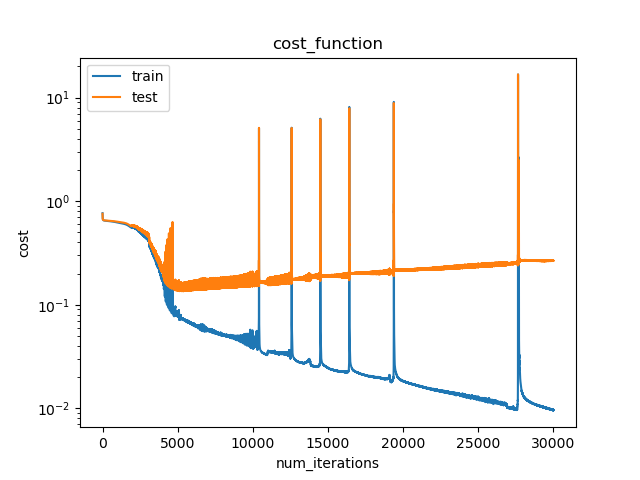

# Deep Neural Networks

## 1. 구현 요약 


## 2. 검증 결과 

### 2.1 기울기 검증 오차 

코드 

```
    error=gradient_checks_test(X_train,Y_train)
    print("기울기 오차: ", error)
```

결과 
> 기울기 오차:  3.561108342793352e-11

<hr>

### 2.2 환원 검증 

**심층 신경망** 

코드 

```
    layer_dims = [2, 1]

    parameters = {}
    for l in range(1,len(layer_dims)):

        parameters[f"W{l}"] = np.random.randn(layer_dims[l], layer_dims[l-1]) * np.sqrt(2.0 / layer_dims[l-1])
        parameters[f"b{l}"] = np.random.randn(layer_dims[l], 1) * np.sqrt(2.0 / layer_dims[l-1])

    parameters,history=L_layer_model(X_train, Y_train, layer_dims, 30000, 0.2, X_test, Y_test,parameters)
    print("환원 훈련 정확도: ", history["train_accuracy"][-1])
    print("환원 정확도: ",history["test_accuracy"][-1])
```

결과 
> 환원 훈련 정확도:  0.615 <br>
> 환원 정확도:  0.617

<hr>

**로지스틱 회귀**

코드
```
    def predict_fn(X_grid):
        w, b = initialize(X_train.shape[0])

        params, _, _ = optimize(
            w, b, X_train, Y_train,
            num_iterations=30000,
            learning_rate=0.2
        )

        return logistic_predict(params["w"], params["b"], X_grid)

    predict_train=predict_fn(X_train)
    train_accuracy=np.mean(predict_train == Y_train)
    print("로지스틱 회귀 훈련 정확도: ",train_accuracy)
    
    predict_test=predict_fn(X_test)
    test_accuracy=np.mean(predict_test == Y_test)
    print("로지스틱 회귀 시험 정확도: ",test_accuracy)
```

결과 
> 로지스틱 회귀 훈련 정확도:  0.615 <br>
> 로지스틱 회귀 시험 정확도:  0.617

일치 여부 

0으로 초기화 된 심층 신경망의 정확도가 로지스틱 회귀랑 동일하기에 일치한다고 할 수 있다.


<hr>

### 2.3 [2,16,16,1] 시험 정확도

코드 

```
    layer_dims = [2, 16, 16, 1]
    parameters,history=L_layer_model(X_train, Y_train, layer_dims, 30000, 0.2, X_test, Y_test)
    print("훈련 정확도: ", history["train_accuracy"][-1],"시험 정확도: ",history["test_accuracy"][-1])
```

결과 
> 훈련 정확도:  0.9975 시험 정확도:  0.945


### 2.4 비용곡선 





## 3. 실험 A

### 3.1 결과 표 

| # | 설정 | 파라미터 수 | 학습 정확도 | 시험 정확도 | 시험 정확도 90% 도달 | 시험 비용 최소 지점 |
| :-- | :-- | --: | --: | --: | --: | --: |
| A-1 | `[2, 1]` | 3 | 61.5% | 61.7% | - | 478회 |
| A-2 | `[2, 16, 1]` | 65 | 67.5% | 63.9% | - | 10,494회 |
| A-3 | `[2, 64, 1]` | 257 | 72.5% | 65.3% | - | 23,462회 |
| A-4 | `[2, 256, 1]` | 1,025 | 98.5% | 93.7% | 24,000회 | 30,000회 |
| A-5 | `[2, 16, 16, 1]` | 337 | 99.5% | 95.0% | 2,700회 | 5,317회 |
| A-6 | `[2, 32, 16, 8, 1]` | 769 | 100.0% | 95.5% | 800회 | 1,653회 |

<hr>

**A-1, A-5, A-6 결정경계**


### 3.2 추가 학습 


| # | 학습 정확도 | 시험 정확도 | 시험 정확도 90% 도달 | 시험 비용 최소 지점 |
| :-- | --: | --: | --: | --: |
| A-4 | 98.5% | 93.7% | 24,000회 | 30,000회 |
| A-4 추가 실험 | 99.5% | 95.1% | 67276회 | 54,000회 |

### 3.3 시드 설정 

| # | seed 0 | seed 1 | seed 2 | 
| :-- | --: | --: | --: | 
| A-3 | 70.8% | 73.8% | 72.2%|
| A-3 | 95.2% | 95.7% | 95.4%|


### 생각 해볼 점 


## 4 실험 B

###
