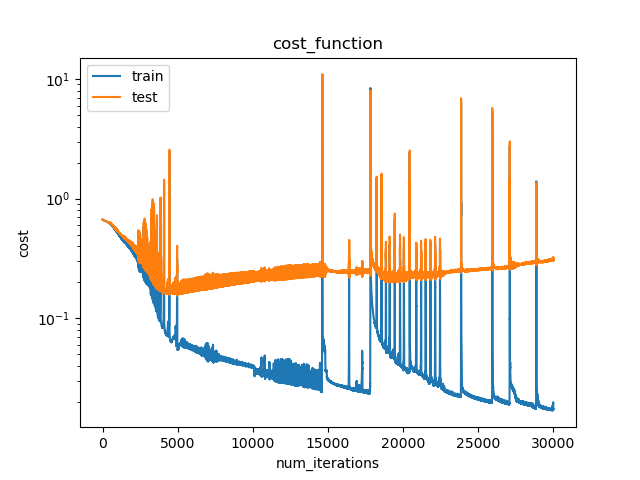
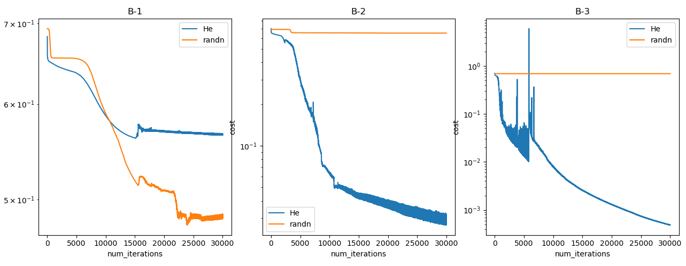

# Deep Neural Networks

## 1. 구현 요약 


## 2. 검증 결과 

### 2.1 기울기 검증 오차 

코드 

```
    error=gradient_checks_test(X_train,Y_train)
    print("기울기 오차: ", error)
```

결과 
> 기울기 오차: 4.425873650008288e-11

<hr>

### 2.2 환원 검증 

**심층 신경망** 

코드 

```
    layer_dims = [2, 1]

    parameters = {}
    for l in range(1,len(layer_dims)):

        parameters[f"W{l}"] = np.zeros((layer_dims[l],layer_dims[l-1]))
        parameters[f"b{l}"] = np.zeros((layer_dims[l], 1))


    parameters,history=L_layer_model(X_train, Y_train, layer_dims, 30000, 0.2, X_test, Y_test,parameters)
    print("환원 훈련 정확도: ", history["train_accuracy"][-1])
    print("환원 정확도: ",history["test_accuracy"][-1])
```

결과 
> 환원 훈련 정확도:  0.615 <br>
> 환원 정확도:  0.617

<hr>

**로지스틱 회귀**

코드
```
    def predict_fn(X_grid):
        w, b = initialize(X_train.shape[0])

        params, _, _ = optimize(
            w, b, X_train, Y_train,
            num_iterations=30000,
            learning_rate=0.2
        )

        return logistic_predict(params["w"], params["b"], X_grid)

    predict_train=predict_fn(X_train)
    train_accuracy=np.mean(predict_train == Y_train)
    print("로지스틱 회귀 훈련 정확도: ",train_accuracy)
    
    predict_test=predict_fn(X_test)
    test_accuracy=np.mean(predict_test == Y_test)
    print("로지스틱 회귀 시험 정확도: ",test_accuracy)
```

결과 
> 로지스틱 회귀 훈련 정확도:  0.615 <br>
> 로지스틱 회귀 시험 정확도:  0.617

**일치 여부** 

0으로 초기화 된 심층 신경망의 정확도가 로지스틱 회귀랑 동일하기에 일치한다고 할 수 있다.


<hr>

### 2.3 [2,16,16,1] 시험 정확도

코드 

```
    layer_dims = [2, 16, 16, 1]
    parameters,history=L_layer_model(X_train, Y_train, layer_dims, 30000, 0.2, X_test, Y_test)
    print("훈련 정확도: ", history["train_accuracy"][-1],"시험 정확도: ",history["test_accuracy"][-1])
```

결과 
> 훈련 정확도: 0.9975 시험 정확도:  0.951

<hr>

### 2.4 비용곡선 




<hr>


## 3. 실험 A

### 3.1 결과 표 

| # | 설정 | 파라미터 수 | 학습 정확도 | 시험 정확도 | 시험 정확도 90% 도달 | 시험 비용 최소 지점 |
| :-- | :-- | --: | --: | --: | --: | --: |
| A-1 | `[2, 1]` | 3 | 61.5% | 61.7% | - | 607회 |
| A-2 | `[2, 16, 1]` | 65 | 72.5% | 70.1% | - | 8,223회 |
| A-3 | `[2, 64, 1]` | 257 | 62% | 59.6% | - | 3,080회 |
| A-4 | `[2, 256, 1]` | 1,025 | 98.5% | 94.1% | 23400회 | 29,999회 |
| A-5 | `[2, 16, 16, 1]` | 337 | 99.75% | 95.6% | 3,200회 | 5,945회 |
| A-6 | `[2, 32, 16, 8, 1]` | 769 | 100.0% | 95% | 1,200회 | 3,361회 |

<hr>

**A-1, A-5, A-6 결정경계**


<hr>

### 3.2 추가 학습 


| # | 학습 정확도 | 시험 정확도 | 시험 정확도 90% 도달 | 시험 비용 최소 지점 |
| :-- | --: | --: | --: | --: |
| A-4 | 98.5% | 94.1% | 23,400회 | 29,999회 |
| A-4 추가 실험 | 99.5% | 95.3% | 23,400회 | 30,745회 |

<hr>

### 3.3 시드 설정 

| # | seed 0 | seed 1 | seed 2 | 
| :-- | --: | --: | --: | 
| A-3 | 59.6% | 65% | 72.6% |
| A-5 | 95.6% | 94.9% | 95.3% |

**seed에 따른 값의 변화**

이는 초기화 시드에 따라서 가중치가 시작하는 위치 즉 도함수상에서의 시작 위치가 달라지게 되면서 <BR>
도달하게 되는 Minima이 달라지게 된다. 

따라서 신경망의 경우 여러 해가 존재하며 이 해의 따라 성능이 달라지게 된다. 

<hr>

### 생각 해볼 점 

**A-2와 A-4 비교**

A-2와 A-4는 깊이가 같지만 파라미터 수에 차이가 있다.  

이 파리미터 차이로 인해서 A-4가 더 복잡한 결정 경계를 표현할 수 있어, <BR>
나선 데이터에서 A-4가 높은 분리 성능을 보여준게 된다.

**A-3와 A-5 비교**

앞선 방식과 달리 A-3와 A-5를 비교 하였을 때 두 모델의 파라미터 갯수는 비슷하다.  <BR>

하지만 신경망은 깊은 층에서 이전 층의 정보를 기반으로 더욱 복잡한 함수를 표현할 수 있다.<br>
이로 인해 A-5 또한 적은 파리미터에서도 복잡한 선형경계를 만들 수 있다


**A-4와 A-5 비교**

A-4와 A-5는 성능 측면에서 비슷한 성능을 가지만 A-5가 시험 성능에서 약간의 우위를 가지게 된다. <BR>
A-5는 A-4보다 적은 학습 반복으로 테스트 정확도 90%에 도달하였다. <BR>

이는 깊어 질수록 데이터에 따른 규칙에 대하여 효율적으로 표현 가능하게 하여, <BR> 
일반화 성능이 좋아지게 되어 좀 더 빠르게 도달한 것으로 보인다<BR>


**깊게 하면 무엇이 좋아지는가?**

앞선 내용을 종합하면, 신경망의 깊이를 늘리는 것은 파라미터 표현 효율과 일반화 성능 측면에서 이점을 줄 수 있다. <BR>

이는 더 깊은 모델은 비슷한 수의 파라미터로 더 복잡한 결정 경계를 표현할 수 있으며, 
일반화 성능이 좋아지는 것을 보여준다.


## 4 실험 B

### 4.1 결과 표 

| # | layer_dims | He 초기화 | randn  | 
| :-- | --: | --: | --: | 
| B-1 | [2, 16, 1]   | 70.1% | 61.4% |
| B-2 | [2, 16, 16, 1] | 95.1% | 94.3% |
| B-3 | [2, 32, 16, 8, 1] | 94.6% |	62.7% |

<hr>

### 4.2 비용 곡선 





<hr>

### 4.3 생각해볼 점

**두 초기화의 차이**

HE 초기화의 경우 B-1,B-2,B-3 모두에서 최적화가 진행 되었지만,  <BR>
randn * 0.01 초기화에서는 신경망이 깊어질수록 학습 비용의 감소가
지연되거나 정체되는 양상이 나타났다.


<hr>

**0.5값을 가지는 모델과 B-3의 학습 값 비교**

코드
```
    cost_05 = compute_cost(np.zeros_like(Y, dtype=float), Y)

    print("항상 0.5를 출력하는 망의 비용:", cost_05)
    print("B-3 randn 최종 학습 비용:", historys_randn[2]["cost_list"][-1])
    return test_accuracy_He,test_accuracy_randn
```

결과 
>  항상 0.5를 출력하는 망의 비용: 0.6931471805599452 <BR>
>  B-3 randn 최종 학습 비용: 0.6931471741078067


**비슷한 이유**

두 신경망이 거의 동일한 비용을 가지게 된다. <BR>

이는 뒤에서 설명하겠지만 randn*0.01의 작은 초기 가중치로 인해 B-3의 마지막 층이 0에 가까운 상태에 머물러, <BR> 시그모이드를 적용한 예측 확률 $A^{[L]}$ 또한 0.5에 가까웠기 때문으로 보인다.

<hr>

**가중치를 작게 시작하면 층을 지날 때마다 신호가 어떻게 되는가**

층이 지날수록  작게 초기화 된 가중치값의 의해서 점점 A값이 작아지게 된다.  <BR>

역전파 과정에서는 dZ의 경우 작은 W값 의해서 층을 지날 수록 작아지게 되어  <br>
 앞쪽 층의 가중치 기울기 dW가 작아져 업데이트가 거의 되지 않게 된다.


## 막혔던 점 

기울기 검증 과정에서 문제가 있었다. 

- 증상
 
> 기울기 오차:  0.7530335965698509

- 원인 

```
    for i in range(L-1, 0, -1):
        dW_reshape = np.asarray(grads[f"dW{i}"]).flatten()
        db_reshape = np.asarray(grads[f"db{i}"]).flatten()

        parts.append(dW_reshape)
        parts.append(db_reshape)
```

역전파 과정과 동일한 코드 방식을 사용하여 flatten 시킬려고 하여 오류가 발생하였다.
이는 theta의 경우 순전파 과정 코드를 사용하였기에 grad_check에서 만들어지는 수치적 기울기는
1 레이어 L를 형태로 나열 되어 해석 기울기와 다른 순서로 나열 되게 되었다.

- 결과 

이를 해결하기 위해서 flatten 과정을 순전파와 동일하게 나열 되도록 바꾸어 해결하였다.

```
def flatten_grads(grads):
    L = len(grads) // 2
    parts = []

    for i in range(1, L+1 ):
        dW_reshape = np.asarray(grads[f"dW{i}"]).flatten()
        db_reshape = np.asarray(grads[f"db{i}"]).flatten()

        parts.append(dW_reshape)
        parts.append(db_reshape)

    theta = np.concatenate(parts)
    return theta
```

**실행 결과** 

> 기울기 오차: 4.425873650008288e-11

## 잘 모르겠는 것

아직 완벽하게 실험 A에서 A-5가 A-4 보다 더 적은 반복 횟수로 
정확도를 90퍼를 도달한 이유에 대해서 명확한 설명을 하지 못하였다.

개인적으로 이를 총 두가지 이유로 생각하고 있다. 
반복 횟수가 낫다는 것은 최적화에서 깊이가 끌어오르는 것이 아닌가 라고 생각하였다.

하지만 기울기 소실과 같은 문제와 연산량 등을 생각해보면 심층 신경망이 최적화의 유리하지 
않다 할 수 있다. 

따라서 컨볼루션과 자연어 처리 분야에서 모델의 크기가 커지고 깊어 질수록,  <BR>
일반화 성능이 좋아지기에 이것이 기여 하여서 빠르게 일반화 성능이 높아졌다고 해석 하였다.

하지만 이를 증명하기 위해서는 A-5와 A-6 사이에서도 좀 더 명확한 성능 변화가 있어야 한다고 생각한다.
결과표를 보면 명확한 성능 변화가 보이지는 않는다. 
그렇기에 현재 해석이 확실한 해석인지가 명확하지 않다.
